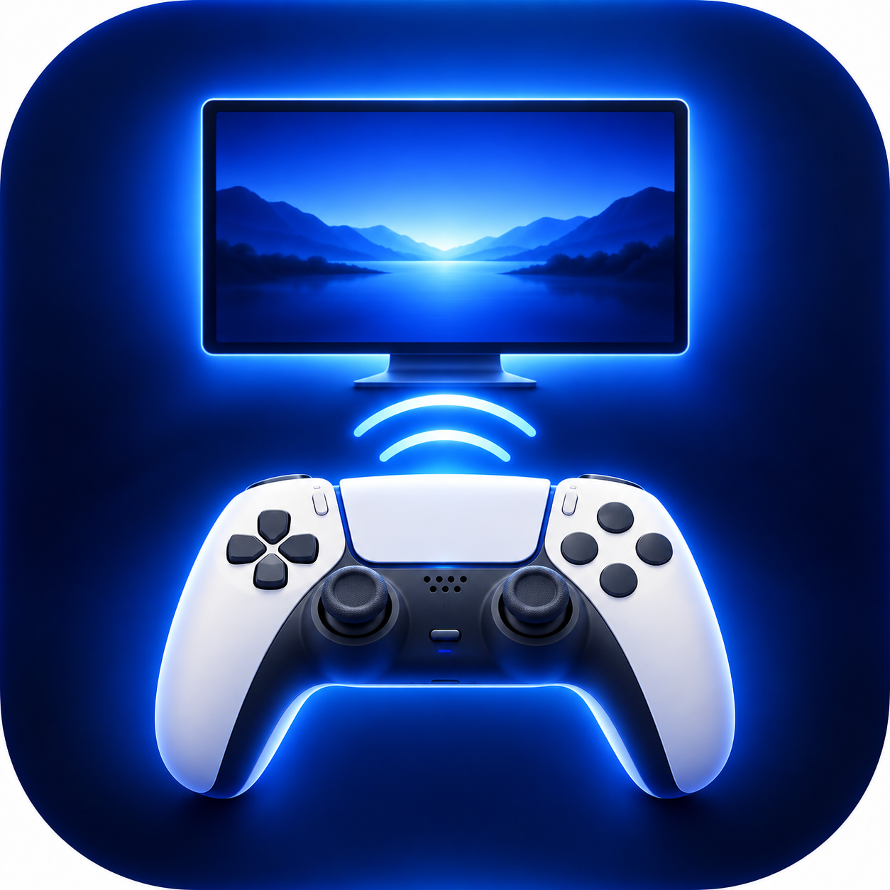

<div align="center">

# DualSense Remote Play
<p align="center">
  
</p>

A lightweight macOS menu bar app that automatically manages PlayStation Remote Play when you connect or disconnect your DualSense controller.

[Report a Bug](https://github.com/Jay5ak/dualsense-remote-play/issues) · [View Releases](https://github.com/Jay5ak/dualsense-remote-play/releases)

</div>

## Overview

DualSense Remote Play detects your DualSense Wireless Controller over Bluetooth and helps manage PS Remote Play on your Mac.

Connect your controller to launch PS Remote Play automatically. Disconnect it to trigger the app's disconnection behavior.

## Features

- Detects a DualSense Wireless Controller connected over Bluetooth.
- Opens PS Remote Play when the controller connects.
- Handles controller disconnection.
- Runs from the macOS menu bar.
- Lightweight native macOS application.

## Requirements

- macOS 13 or later.
- A DualSense Wireless Controller.
- Bluetooth enabled on your Mac.
- [PS Remote Play for Mac](https://remoteplay.dl.playstation.net/remoteplay/lang/en/index.html), installed separately.

## Installation

1. Visit the [latest releases](https://github.com/Jay5ak/dualsense-remote-play/releases).
2. Download `DualSense-Remote-Play.dmg` if it is available.
3. Open the DMG file and drag `DualSense Remote Play.app` into Applications.
4. Pair your DualSense controller in **System Settings → Bluetooth**.
5. Launch DualSense Remote Play.
> **Security note:** DualSense Remote Play may not be notarized by Apple. macOS may display a security warning. Only run software you trust.

## macOS Security Warning

If macOS blocks the app and you have verified that it came from the official GitHub repository:

1. Try opening the app once.
2. Open **System Settings**.
3. Select **Privacy & Security**.
4. Scroll down to the **Security** section.
5. If available, click **Open Anyway**.
6. Confirm that you want to open the app.

Only bypass this warning if you trust the application and its source.

Official repository: https://github.com/Jay5ak/dualsense-remote-play

## How to Use

1. Install and configure PS Remote Play.
2. Pair your DualSense controller with your Mac over Bluetooth.
3. Open DualSense Remote Play.
4. Connect your controller and let the app detect it.
5. Disconnect the controller when you are finished.

## Build from Source

You need Xcode Command Line Tools or a compatible Swift toolchain.

Clone the repository:

```bash
git clone https://github.com/Jay5ak/dualsense-remote-play.git
cd dualsense-remote-play
